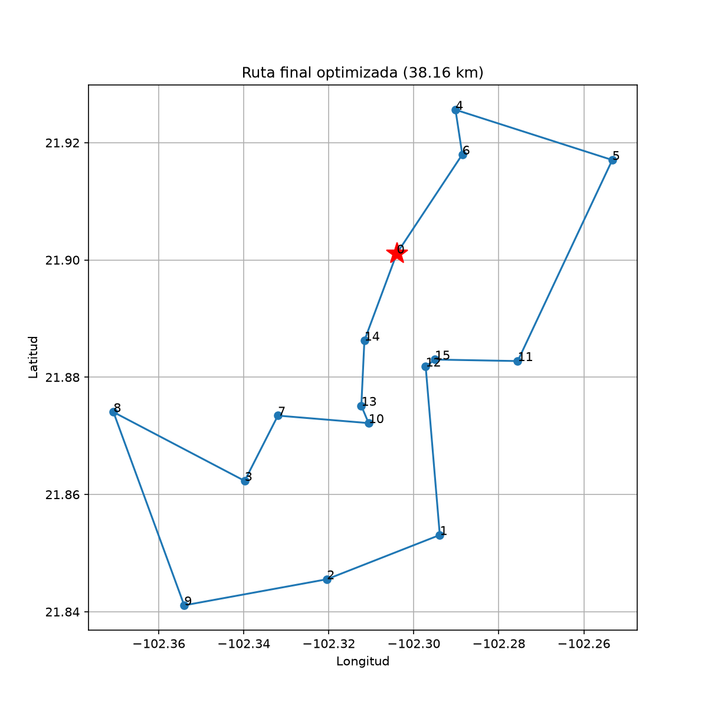

# Optimización de rutas de distribución con un algoritmo genético

Proyecto 5 de Fundamentos de Inteligencia Artificial – Universidad Tecnológica de Aguascalientes.

Algoritmo genético en Python que encuentra la ruta más corta para visitar 15 destinos de Aguascalientes y regresar al punto de partida.

## Resultados

| Ruta | Distancia |
| --- | --- |
| Orden de la lista (ruta inicial) | 60.65 km |
| Algoritmo genético, configuración final | **38.16 km** (óptima, 37.1% de mejora) |



## Cómo funciona

- **Distancias:** fórmula de Haversine y matriz de 16×16.
- **Selección:** torneo.
- **Cruce:** de orden (OX), que siempre produce rutas válidas.
- **Mutación:** intercambio (swap).
- **Elitismo:** las 2 mejores rutas pasan intactas a la siguiente generación.
- **Configuración final:** población 400, mutación 0.01, torneo 3, 500 generaciones, semilla 17.

## Archivos

- `rutas_ags.ipynb`: desarrollo paso a paso, experimentos y gráficas.
- `menu_rutas.py`: menú por consola para agregar o quitar destinos y recalcular la ruta.
- `requirements.txt`: librerías necesarias.

## Instalación y uso

```bash
python -m venv .venv
.venv\Scripts\activate
python -m pip install -r requirements.txt
```

- **Notebook:** abre `rutas_ags.ipynb` en VS Code, elige el kernel `.venv` y ejecuta **Run All**.
- **Menú por consola:** `python menu_rutas.py`

## Autor

Omar Eduardo Ornelas Hernández – 7-C-11